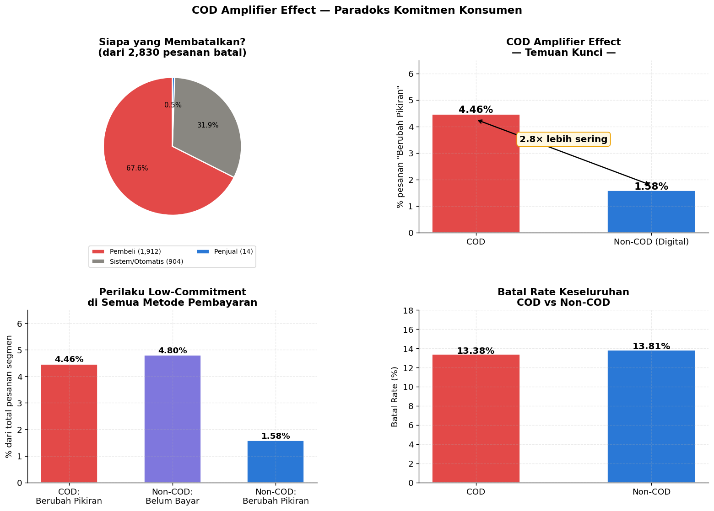
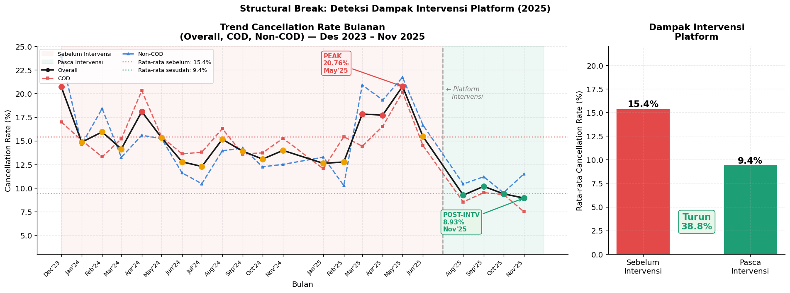
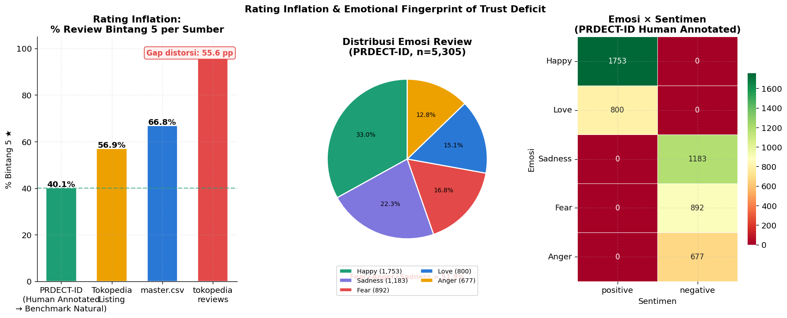
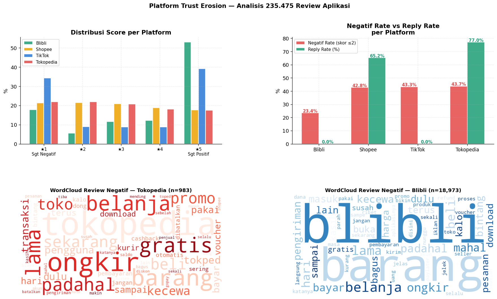

# Jebakan COD: Analisis Amplifikasi Impulsif & Distorsi Sinyal Pasar E-Commerce Indonesia (TECHFEST 2026)


## Ringkasan Proyek

Proyek ini membedah fenomena tingginya transaksi *Cash on Delivery* (COD) di e-commerce Indonesia dengan mengintegrasikan **392.971 baris data dari 4 sumber** (20.848 transaksi Shopee, 235.475 ulasan aplikasi Google Play Store, 109.833 ulasan produk, dan 26.815 listing Tokopedia). Analisis membuktikan bahwa dominasi COD bukan sekadar masalah ketidakpercayaan pada penjual, melainkan mekanisme *low-commitment* yang memperbesar pembelian impulsif dan pembatalan sepihak, serta terhubung dengan distorsi rating produk dan erosi kepercayaan platform.

## Hasil & Temuan Utama

| Temuan / Komponen Analisis | Hasil Utama |
|---|---|
| **Verifikasi Hipotesis** | **9 dari 10 hipotesis** lintas 4 dataset terkonfirmasi secara statistik |
| **COD Amplifier Effect** | Pembeli COD **2,8× lebih sering** membatalkan dengan alasan *"berubah pikiran"* (4,46% vs 1,58%; χ² = 138,51, p < 0,0001) |
| **Anatomi Pembatalan & Harga** | **67,6%** dari 2.830 pembatalan diinisiasi oleh pembeli sendiri; **84,4%** transaksi COD bernilai < Rp50.000 (median Rp21.800) |
| **Structural Break Intervensi** | Kebijakan pembatasan COD & *"COD Cek Dulu"* memangkas rata-rata *cancellation rate* sebesar **36,8%** (14,92% → 9,44%; puncak 20,76% → 8,93% dalam 4 bulan) |
| **Rating Inflation** | **95,7%** ulasan produk di platform berupa bintang 5 vs benchmark natural **40,1%** pada PRDECT-ID (gap 55,6 pp); **56,9%** listing memiliki rating sempurna 5,0 |
| **Trust Erosion (App Reviews)** | **36,6%** dari 235.475 ulasan aplikasi bersentimen negatif (Shopee 42,8%, Tokopedia 43,7%, TikTok 43,3% vs Blibli 23,4%); **26%** keluhan negatif menyinggung COD & pembatalan |
| **Consumer Commitment Index (CCI) & ML** *(oleh tim)* | Pemetaan CCI per provinsi (tertinggi NTB 20,44 & Sulteng 20,07) serta 4 model ML: *Pre-Shipment Risk Classifier* (Random Forest, ROC-AUC **0,749**), *Buyer Segmentation* (KMeans k=4), *Sentiment Classifier* (TF-IDF + LogReg, akurasi **94,5%**), dan *Forecasting* 12 bulan (Prophet) |

### Visualisasi Kunci


*Perbandingan mekanisme pembatalan: pembeli COD 2,8× lebih sering membatalkan karena berubah pikiran dibandingkan Non-COD.*


*Penurunan tajam tingkat pembatalan setelah intervensi platform pada pertengahan 2025 (dari puncak 20,76% ke 8,93%).*


*Gap 55,6 poin persentase antara proporsi ulasan bintang 5 di platform (95,7%) dan benchmark beranotasi manual PRDECT-ID (40,1%).*


*Distribusi skor dan tingkat ulasan negatif antar platform e-commerce pada 235.475 ulasan Google Play Store.*

## Alur Analisis

1. **Data Understanding & Integrasi Multi-Sumber:** Pembersihan, normalisasi, dan deduplikasi 10 berkas mentah menjadi 4 dataset terstruktur (transaksi, *app reviews*, *product reviews*, dan listing produk).
2. **Exploratory Data Analysis (EDA):** Investigasi dominasi COD, segmentasi harga × metode bayar, pola temporal pesanan, *structural break* pasca-intervensi, inflasi rating, dan *spillover* keluhan ke reputasi aplikasi.
3. **Hypothesis Testing Lintas Dataset:** Pengujian statistik (Chi-Square, perbandingan proporsi, analisis tren) terhadap 10 hipotesis perilaku konsumen dan distorsi sinyal pasar.
4. **Consumer Commitment Index & Pemodelan ML:** Perumusan metrik geografis CCI per provinsi serta pengembangan 4 model ML (*risk scoring*, segmentasi, NLP sentimen, *forecasting*) dan arsitektur solusi intervensi COD bertingkat.

## Kontribusi Saya

- Berperan utama pada tahap **data understanding, pembersihan, dan integrasi 4 sumber data**.
- Mengerjakan **Exploratory Data Analysis (EDA)** inti: analisis *COD Amplifier Effect*, korelasi harga rendah × COD, pola temporal, *structural break* intervensi platform, *rating inflation*, dan *trust erosion* pada ulasan aplikasi.
- Menyusun dan menjalankan **pengujian hipotesis statistik** lintas dataset beserta interpretasi temuan utamanya.
- *(Catatan: analisis lanjutan Consumer Commitment Index dan 4 model Machine Learning dikerjakan oleh rekan tim.)*

## Struktur Repository

```text
techfest-cod-ecommerce-analysis/
├── README.md
├── assets/
│   ├── 01_cod_amplifier.png
│   ├── 02_structural_break.png
│   ├── 03_rating_inflation.png
│   └── 04_trust_erosion.png
├── docs/
│   └── presentation_deck.pdf
└── notebooks/
    └── cod_ecommerce_analysis.ipynb
```

- Notebook analisis lengkap: [`notebooks/cod_ecommerce_analysis.ipynb`](notebooks/cod_ecommerce_analysis.ipynb)
- Deck presentasi kompetisi: [`docs/presentation_deck.pdf`](docs/presentation_deck.pdf)

## Tim

**Tim `tekpescsv`** — TECHFEST 2026 (Fakultas Ilmu Komputer, Universitas Indonesia)
- Tirta Rendy Siahaan
- Fakhri Husaini Romza
- Muhathir Muhammad Radian Oki
